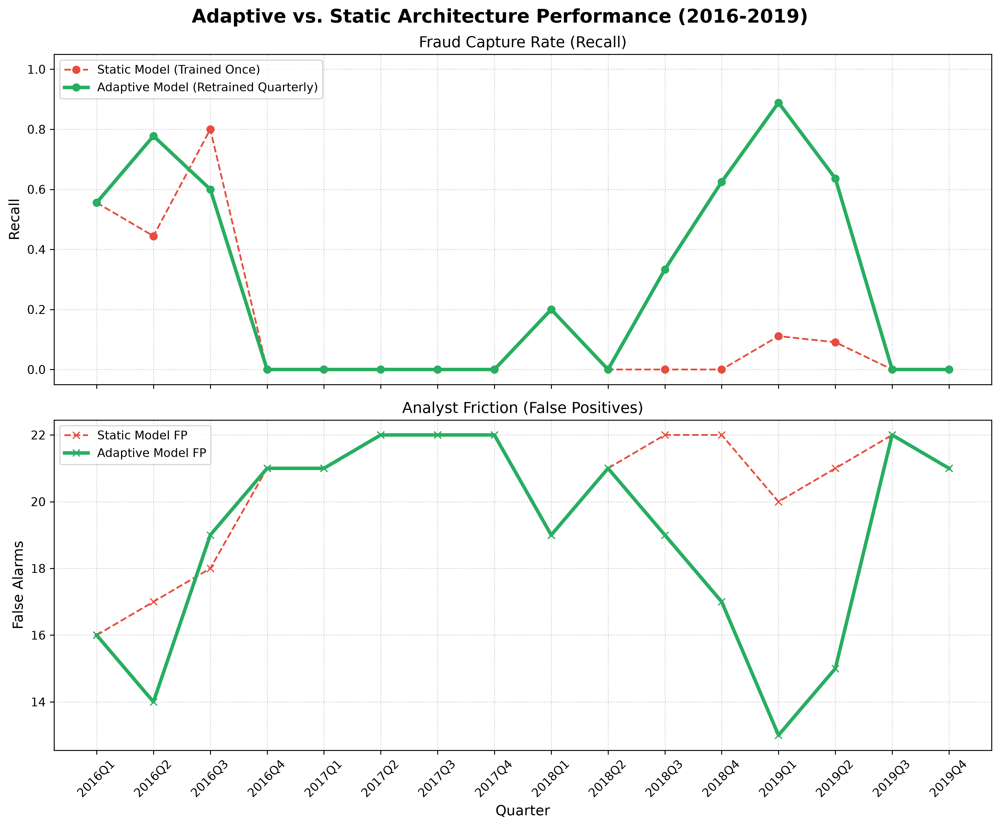
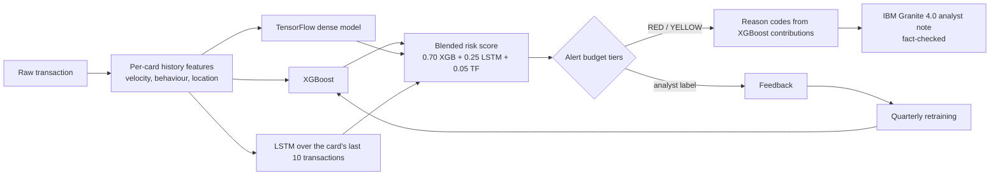

# Viadrina_IBM Z Datathon 2026 Project: Adaptive Credit Card Fraud Detection

**Theme:** Real-time AI for critical decisions · **Platform:** IBM LinuxONE (IBM Z, s390x) · **Team:** Viadrina

Credit card fraud changes faster than rule-based systems can follow. Our system scores every transaction in real time
with three models running on IBM LinuxONE, explains each alert in plain language, keeps alert volume within a fixed
analyst budget, and retrains as confirmed fraud labels arrive, so it recovers when a new fraud pattern appears.

## Results at a glance

| What | Result |
|---|---|
| Fraud caught on a **new fraud pattern** (merchants in Italy, from late 2017), 2017Q4–2019Q2 | **static model 5 of 70, adaptive model 28 of 70** |
| All frauds 2016–2019 in the stream replay | static 18 of 93, adaptive 42 of 93 |
| Validation (2016–2017), blended model, PR-AUC | 0.364 (XGBoost alone 0.336) |
| Validation, highest-risk tier (RED, 1 alert per 1,000 transactions) | 34 alerts, 13 of them fraud |
| Scoring latency on LinuxONE, one transaction, all 3 models + reason codes | 25 ms median (26 ms p95) |
| IBM Z AI accelerator | NNPA present, `ibm-zdnn-plugin` 2.3.0 kernels loaded in the TensorFlow process |



## Architecture



Everything runs on an IBM LinuxONE Community Cloud VM: training in Jupyter Lab, inference in a Flask API inside its
own Docker container, and the IBM Granite language model through `llama.cpp`.

## Data

`transactions_history.csv` (IBM synthetic credit card data, provided in the LinuxONE Jupyter image):
245,864 transactions, 1999–2020, 271 labelled frauds (0.11%). We split **by time**, never randomly:

| Split | Years | Frauds | Used for |
|---|---|---|---|
| Train | up to 2015 | 178 | fitting all models |
| Validation | 2016–2017 | 33 | early stopping, blend weights, thresholds |
| Test | 2018–2019 | 60 | one final evaluation with frozen settings |

## Features

24 features per transaction. Every history feature only uses the card's **earlier** transactions; the notebook
proves this by recomputing all of them on data cut at 2010 and getting identical values (max difference 0.0).

- Transaction: amount, hour, weekday, refund, chip / swipe / online, merchant category (MCC), terminal errors,
  foreign merchant (merchant state outside the US)
- Velocity per card: transactions in the last 1 h / 24 h / 7 days, amount spent in the last 24 h, minutes since the
  previous transaction
- Behaviour per card: amount ÷ the card's median so far, first purchase at this merchant, first purchase in this city

## Models (validation 2016–2017, 33,654 transactions, 33 frauds)

Fraud is 0.11% of transactions, so we report at a fixed **alert budget of 5 per 1,000 transactions** and use PR-AUC
(average precision), never accuracy.

| Model | PR-AUC | Precision | Recall | Alerts per 1,000 |
|---|---|---|---|---|
| XGBoost | 0.336 | 0.077 | 0.394 | 5.0 |
| TensorFlow dense | 0.082 | 0.063 | 0.333 | 5.2 |
| LSTM (sequence of the card's last 10 transactions) | 0.026 | 0.023 | 0.121 | 5.2 |
| **Blend** (weights chosen on validation: 0.70 / 0.25 / 0.05) | **0.364** | | | |

Routing on validation: **RED** = top 1 per 1,000 (34 alerts, 13 frauds), **YELLOW** = next 4 per 1,000
(135 alerts, 1 fraud), **CLEAR** = everything else.

## Adaptive retraining (stream replay 2016–2019)

The notebook replays 2016–2019 quarter by quarter. A fraud label becomes known 30 days after the transaction. The
**static** model is trained once on data up to 2015; the **adaptive** model is retrained at the end of every quarter
on the last 2 years of known labels. Both raise the same number of alerts (5 per 1,000), so the comparison is only
about which transactions they flag.

In 2017Q4 a new pattern appears: fraud at merchants in Italy, never seen in training. The static model keeps missing
it (5 of 70 caught). The adaptive model learns it within three quarters: recall 0.33 in 2018Q3, **1.00 in 2018Q4**,
0.89 in 2019Q1 (28 of 70 caught overall).

**Final test (2018–2019, frozen validation settings, run once):** the frozen blended model catches 7 of 60 frauds
(recall 0.117 at 3.8 alerts per 1,000). This is the cost of not adapting: almost all test fraud belongs to the new
pattern. Over the same two years the adaptive replay catches 27 of 60.

## Explainability

Every RED and YELLOW alert gets up to three **reason codes** built from XGBoost's per-feature contributions
(`pred_contribs`) and the transaction's own values, for example:

1. Amount $267.66 is 14.6x this card's usual amount
2. Online purchase without the physical card
3. Only 6 minutes since this card's previous transaction

For RED alerts, **IBM Granite 4.0 (350M, big-endian build for IBM Z)** turns the reasons into one analyst sentence
(`temperature=0`, few-shot prompt). A guard keeps the sentence only if it is complete and every number and fact word in
it appears in the reasons; otherwise the note is built from the reasons directly. Example:

> RED alert on a $267.66 online purchase, about 14.6 times this card's usual amount, after 6 minutes since this card's
> previous transaction.

## IBM LinuxONE

Measured by the notebook's LinuxONE cell (`docs/linuxone_proof.json`):

| Check | Result |
|---|---|
| Machine | s390x (IBM Z) |
| CPU facility for the on-chip AI accelerator (NNPA) | present |
| `ibm-zdnn-plugin` | 2.3.0, kernel library `_z_ops.so` loaded in the TensorFlow process |
| TensorFlow dense model, 1,000 transactions | 2.0 ms |
| LSTM, 1,000 sequences | 31 ms |
| One transaction, all 3 models + reason codes | 25 ms median, 26 ms p95 |
| ONNX export | `tf_dense.onnx` (24 KB), `lstm.onnx` (63 KB) with `tf2onnx` |

**Engineering note:** on this LinuxONE image, Keras' compiled `predict()` / `evaluate()` graphs kept the weights from
their first trace, so validation metrics during training never changed. We found it, verified it, and fixed it
(`FreshValidationGraph` callback; direct model calls in the API).

## Scoring API

`api/app.py` (Flask) runs in its own Docker container. The client sends the **raw transaction**; the API computes the
features from each card's history in memory, with the same definitions as the notebook. Verified: identical features
for all 33,654 validation transactions and the same risk tier for 2,276 of 2,276 sampled transactions.

| Endpoint | Purpose |
|---|---|
| `POST /score` | raw transaction → risk score, tier, reasons, per-model scores, latency |
| `POST /explain` | tier, amount, reasons → Granite analyst note (about 9 s on CPU, so it is a separate call) |
| `POST /feedback` | analyst label (`fraud` / `not_fraud`) for a scored transaction, stored for the next retraining |
| `GET /health` | models loaded, cards in memory |
| `GET /` | **analyst page** (see below) |

### Analyst page

Open `http://<VM IP>:5000` in any browser; nothing to install. An analyst picks a transaction (four real
transactions from the validation period, or a custom one), clicks **Score**, and sees the tier, the risk score
against the alert thresholds, the reasons, each model's score and the scoring time. **Write note with IBM Granite**
adds the fact-checked analyst note, and **Confirm fraud / Not fraud** stores the verdict for the next retraining.
The example scores are deterministic: before scoring, the page rebuilds that card's history from the data, so the
$267.66 payment always returns RED 0.9485 with the reasons shown below, and the payment in Rome (November 2017, the new
pattern) shows what the model trained up to 2015 misses.

Run on the LinuxONE VM (after the notebook has saved the models to `/home/linux1/shared/models/`):

```bash
cd ~/shared/Viadrina_IBM-Z-Datathon-2026-Project
docker build -t fraud-api api/
docker run -d --name fraud-api --network host -v /home/linux1/shared:/home/ibm-user/shared fraud-api
sudo iptables -I INPUT -p tcp --dport 5000 -j ACCEPT
curl http://localhost:5000/health
```

Start-up takes about a minute (it loads each card's history up to `HISTORY_END`, default 2016-01-01, so 2016+
transactions can be replayed).

Example: a confirmed fraud from the validation period (response values as returned by our test run; `latency_ms`
varies). The API needs each card's transactions in date order: to get exactly this response, first send card 13/0's
earlier 2016 transactions, or start the container with `-e HISTORY_END="2016-07-24 10:41"`.

```bash
curl -X POST http://localhost:5000/score -H "Content-Type: application/json" -d '{
  "User": 13, "Card": 0, "Year": 2016, "Month": 7, "Day": 24, "Time": "10:41", "Amount": "$267.66",
  "Use Chip": "Online Transaction", "Merchant Name": -4282466774399734331, "Merchant City": "ONLINE",
  "Merchant State": null, "Zip": null, "MCC": 4829, "Errors?": null}'
```

```json
{"transaction_id": "13-0-201607241041", "score": 0.948523, "action_tier": "RED", "flagged": true,
 "reasons": ["Amount $267.66 is 14.6x this card's usual amount", "Online purchase without the physical card",
             "Only 6 minutes since this card's previous transaction"],
 "model_scores": {"xgboost": 0.996086, "lstm": 0.80571, "tf_dense": 0.996702}, "latency_ms": 46.51}
```

## Reproduce

1. On a LinuxONE Community Cloud VM (image *Ubuntu 24.04-Datathon*), start IBM's Jupyter Lab ML container
   (`registry.linuxone.cloud.marist.edu/l1cc/jupyterlab-image-s390x`), which includes the data and the Granite model.
2. Clone this repository into `~/shared` and open `Viadrina_Fraud_Detector.ipynb`.
3. **Kernel → Restart Kernel and Run All Cells** (about 2 minutes). The notebook trains the models, prints every
   number in this README, saves the models to `/home/ibm-user/shared/models/` and writes `docs/`.
4. Start the API as shown above.

`Viadrina_Fraud_Detector.py` is the same notebook exported as a script.

## Repository

```
Viadrina_Fraud_Detector.ipynb   full pipeline with outputs: data, features, models, reasons, Granite, replay, LinuxONE proof, test
Viadrina_Fraud_Detector.py      the notebook as a script
api/app.py                      real-time scoring API (Flask)
api/analyst.html                analyst page served by the API at /
api/Dockerfile                  container for the API, based on IBM's LinuxONE AI image
docs/adaptive-chart.png         static vs adaptive chart
docs/linuxone_proof.json        accelerator, latency and ONNX numbers
```

## Limitations

- 271 frauds from 19 cardholders, and the validation set has 33; validation numbers, blend weights and thresholds
  carry large uncertainty.
- Only XGBoost is retrained in the adaptive loop; the TensorFlow and LSTM models stay frozen.
- The API keeps card history in memory (lost on restart); a production system would use a database.
- Granite notes are drafts for analysts; the reason codes are the source of truth.

## Open-source software and models used

- [TensorFlow](https://www.tensorflow.org/) and [Keras](https://keras.io/)
- [XGBoost](https://xgboost.ai/)
- [scikit-learn](https://scikit-learn.org/), [pandas](https://pandas.pydata.org/), [NumPy](https://numpy.org/),
  [Matplotlib](https://matplotlib.org/), [joblib](https://joblib.readthedocs.io/)
- [tf2onnx](https://github.com/onnx/tensorflow-onnx) and [ONNX](https://onnx.ai/)
- [llama-cpp-python](https://github.com/abetlen/llama-cpp-python) / [llama.cpp](https://github.com/ggml-org/llama.cpp)
- [IBM Granite 4.0](https://www.ibm.com/granite) (350M base, big-endian GGUF provided in the LinuxONE image)
- [Flask](https://flask.palletsprojects.com/)
- [IBM ibm-zdnn-plugin](https://pypi.org/project/ibm-zdnn-plugin/) for the IBM Z AI accelerator
- Reference (not copied): IBM's [jupyter-lab-ml](https://github.com/linuxone-community-cloud/jupyter-lab-ml) demo
  notebooks for LinuxONE
